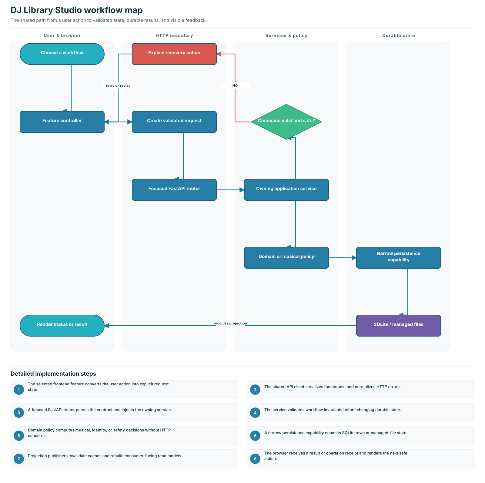

# Application workflow atlas

Use this atlas to answer three questions quickly:

1. What is called, and in what order?
2. Which layer owns each decision?
3. Where does state become durable and visible?

Each diagram shows only the primary call path. The small `(1)`, `(2)`, and later
labels above the cards are the execution order. Alternate paths are summarized
below the main path instead of being drawn as crossing arrows.



## Find a flow

| Workflow                                                            | Use it to understand                                                  |
| ------------------------------------------------------------------- | --------------------------------------------------------------------- |
| [Startup and navigation](startup-and-navigation.md)                 | App construction, asset revisioning, and page loading                 |
| [Imports](imports.md)                                               | Local files, playlist matching, authorized URLs, and Creative Commons |
| [Track processing](track-processing.md)                             | Analysis, edit creation, rendering, and queue state                   |
| [Music Files and catalog](music-files-and-catalog.md)               | Catalog browsing, metadata changes, and file synchronization          |
| [DJ Library](dj-library.md)                                         | Search projection, musical profiles, and stale-response protection    |
| [Set Builder](set-builder.md)                                       | Brief interpretation, candidate planning, editing, saving, and export |
| [Review, feedback, and reporting](review-feedback-and-reporting.md) | Human decisions, corrections, preference signals, and reports         |
| [Settings and operations](settings-and-operations.md)               | Configuration, relocation, backup, cleanup, and diagnostics           |
| [Data and persistence](data-and-persistence.md)                     | SQLite ownership, managed files, caches, and projections              |

## The ownership rule

| Layer                  | Owns                                  | Does not own         |
| ---------------------- | ------------------------------------- | -------------------- |
| Frontend feature       | User interaction and request state    | Durable policy       |
| Router                 | HTTP parsing and response translation | Workflow decisions   |
| Application service    | Workflow order and invariants         | SQL implementation   |
| Domain module          | Musical, identity, and safety policy  | HTTP presentation    |
| Persistence capability | Transactions and durable records      | User-interface state |

Long-running work returns an operation ID. The browser polls a status endpoint
until the operation is completed, failed, or canceled; it does not keep the
initial request open.

## Maintaining the atlas

When a workflow changes:

1. Update the numbered calls in `scripts/development/render_workflow_diagrams.py`.
2. Keep this page focused on ownership; link to deeper architecture documents
   instead of copying implementation details.
3. Regenerate and validate the SVG files:

   ```bash
   .venv/bin/python scripts/development/render_workflow_diagrams.py
   .venv/bin/python -m unittest tests.unit.architecture.test_workflow_diagrams -q
   ```

See [code organization](../architecture/code-organization.md) and the
[architecture guide](../architecture/architecture.md) for package boundaries
and compatibility constraints.
