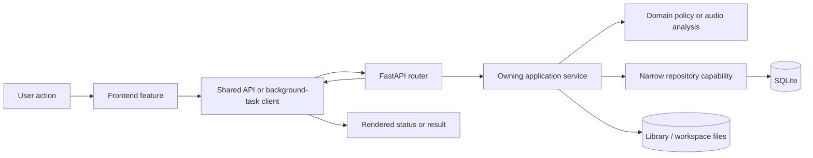
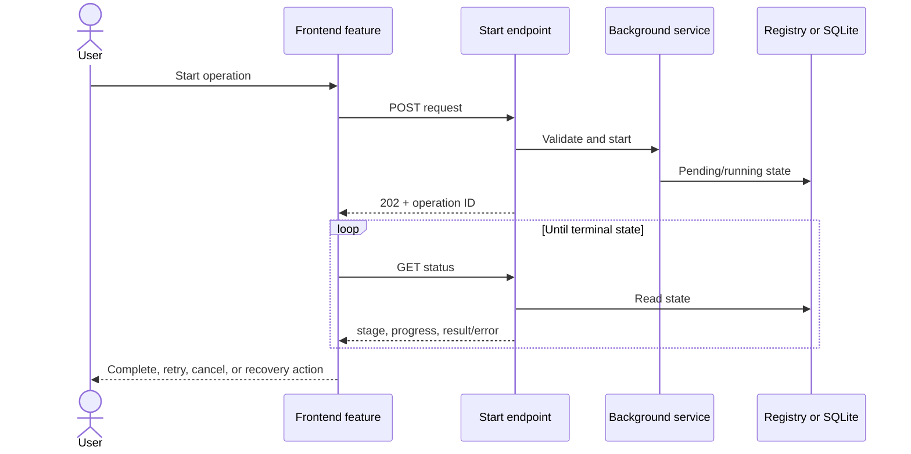

# Application workflow atlas

This directory explains how DJ Library Studio works from a user action to the
browser module, HTTP endpoint, application service, persistence boundary, and
result shown on screen. It is intended to answer questions such as:

- Where does this workflow begin?
- Which function owns the decision?
- Which request or result model crosses the boundary?
- What runs in the background?
- What is saved, cached, or written to disk?
- What should be tested when the workflow changes?

The diagrams describe ownership and data movement, not every helper call. Follow
the linked source modules for implementation details.


The rendered diagrams use the same visual language throughout: cyan pills are
entry or completion states, blue rectangles are actions, green diamonds are
decisions, purple rectangles are durable stores, and red rectangles are stopped
or failed paths. Columns show which layer owns each step. Below every flowchart,
a numbered implementation sequence names the concrete controllers, routes,
models, services, persistence calls, background behavior, and recovery outcome.

## Choose a workflow

| User workflow                                                       | Document                                                            | Primary browser owner                              | Primary backend owner                                                 |
| ------------------------------------------------------------------- | ------------------------------------------------------------------- | -------------------------------------------------- | --------------------------------------------------------------------- |
| Start the app and change pages                                      | [Startup and navigation](startup-and-navigation.md)                 | `frontend/app.js`, `core/navigation-controller.js` | `web/application.py`, `web/composition.py`                            |
| Import local files, playlist CSVs, URLs, or Creative Commons tracks | [Imports](imports.md)                                               | `features/imports/`                                | `imports/`, `web/routes/imports.py`, `web/routes/creative_commons.py` |
| Analyze a track or create an extended edit                          | [Track processing](track-processing.md)                             | `features/processing/`                             | `processing/`, `analysis/`, `audio/`                                  |
| Browse, edit, analyze, or repair imported WAVs                      | [Music Files and catalog](music-files-and-catalog.md)               | `features/music-files/`                            | `library/`, downloaded-library routers                                |
| Explore the analyzed DJ library and compatibility                   | [DJ Library](dj-library.md)                                         | `features/dj-library/`                             | `web/routes/library_routes.py`, reporting projections                 |
| Describe, generate, edit, save, and export a set                    | [Set Builder](set-builder.md)                                       | `features/set-builder/`                            | `set_builder/`, Set Builder routers                                   |
| Review candidates and submit corrections or ratings                 | [Review, feedback, and reporting](review-feedback-and-reporting.md) | processing/reporting/Set Builder feedback features | job-review, reporting, preference, and set-review services            |
| Configure storage, backup, relocation, cleanup, and diagnostics     | [Settings and operations](settings-and-operations.md)               | `features/settings/`                               | settings, maintenance, quality, and diagnostic services               |
| Understand SQLite, files, projections, caches, and propagation      | [Data and persistence](data-and-persistence.md)                     | shared API/request state                           | `persistence/`, projection and mutation services                      |

## The common request shape

Most browser workflows follow the same dependency direction:



The important ownership rule is: **the router translates HTTP, the service owns
the workflow, the domain module owns policy, and the persistence package owns
SQL**. Frontend features coordinate user interaction but must not duplicate
server-side validation or musical authority.

## Background-operation shape

Long-running work returns an identifier rather than holding the first HTTP
request open:



The shared vocabulary is defined by
`audioextender/infrastructure/operation_lifecycle.py`; feature services retain
ownership of execution, recovery, cancellation, and durable storage.

## How to maintain these documents

When a workflow changes:

1. Update the relevant flow and function/model table.
2. Keep route paths in the document aligned with their router factory.
3. Link to ownership rather than copying algorithms into documentation.
4. Update the browser, route-contract, service, and persistence tests named in
   the document.
5. Refresh `graphify-out/` after the structural commit so architecture queries
   see the new relationships.

Regenerate every SVG after changing its source definition:

```bash
.venv/bin/python scripts/development/render_workflow_diagrams.py
```

For directory placement rules, see
[code organization](../architecture/code-organization.md). For compatibility
constraints, see [the architecture guide](../architecture/architecture.md) and
the [architecture decisions](../decisions/README.md).
