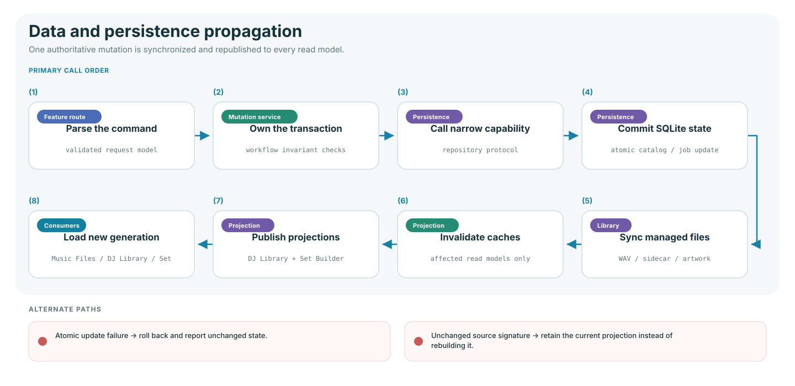
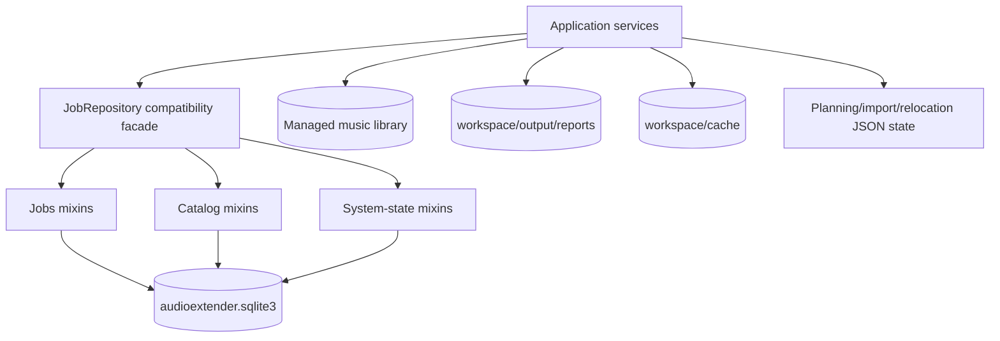
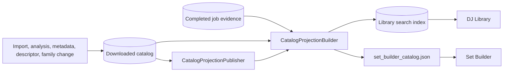
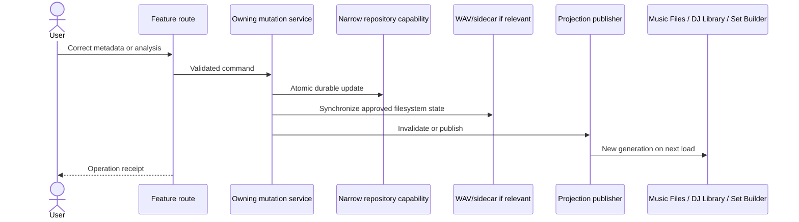

# Data, persistence, and propagation map

This document explains where state lives and how a change becomes visible across
the app. “Repository” here means the code boundary that reads and writes durable
SQLite records. It does not mean the Git repository.

## Storage map

## SQLite ownership

`JobRepository` composes focused mixins for compatibility. New services should
depend on the narrowest protocol in `persistence/capabilities.py` rather than the
whole facade.

| Persistence module              | Durable responsibility                                           | Representative methods                                                                    |
| ------------------------------- | ---------------------------------------------------------------- | ----------------------------------------------------------------------------------------- |
| `jobs/queue.py`                 | Processing jobs, status, config, artifacts, analytics            | `create`, `update`, `list_jobs_page`, `recover_interrupted`                               |
| `jobs/feedback.py`              | Candidate/track feedback and BPM/key verification                | `add_feedback`, `add_track_feedback`, `set_key_verification`, `set_bpm_verification`      |
| `jobs/library_analysis.py`      | DJ Library search projection and Set Builder source projection   | `replace_library_search_index`, `page_library_tracks`, `list_set_builder_tracks`          |
| `catalog/core.py`               | Downloaded-track upsert, list, fingerprint, duplicate candidates | `upsert_downloaded_track`, `list_downloaded_tracks`, `duplicate_candidates`               |
| `catalog/metadata.py`           | Metadata, paths, artwork, import failures, deletion              | `update_downloaded_track_metadata`, `relocate_downloaded_tracks`, `record_import_failure` |
| `catalog/descriptors.py`        | Identity descriptors, inference protection, vocabulary           | `update_track_descriptors`, `replace_inferred_track_descriptors`                          |
| `catalog/recording_families.py` | Recording/version relationships                                  | `recording_family`, `link_recording_version`, `merge_downloaded_tracks`                   |
| `catalog/analysis.py`           | Audio-quality and key-analysis evidence                          | `update_audio_quality`, `update_downloaded_track_key_analysis`                            |
| `catalog/projections.py`        | Paginated Music Files read model and facets                      | `page_downloaded_tracks`, `downloaded_catalog_facets`                                     |
| `system/state.py`               | Settings and named application state                             | `get_settings`, `replace_settings`, `get_system_state`, `set_system_state`                |

Schema creation and compatibility upgrades belong to ordered, idempotent steps
in `persistence/migrations/schema.py`. A route or service must never contain SQL.

## Filesystem ownership

| Location                      | Contents                                                                                                          | Authority                                               |
| ----------------------------- | ----------------------------------------------------------------------------------------------------------------- | ------------------------------------------------------- |
| Managed music library         | Cataloged WAVs, genre folders, `_Playlist`, `.audioextender` sidecars/artwork                                     | Catalog paths plus verified files                       |
| `workspace/output/reports/`   | SQLite database, processing report, presets, Set Builder projection and planning state, import/relocation reports | Owning service for each file                            |
| `workspace/cache/`            | Rebuildable analysis/stem caches                                                                                  | Source/config revision controls validity                |
| `workspace/input/`            | CLI and local workflow input staging                                                                              | User/source file is authoritative until import succeeds |
| `track_overrides.json`        | Compatibility track overrides                                                                                     | Reporting service                                       |
| Browser local/session storage | UI state, filter state, recovery cache                                                                            | Never authoritative for catalog or musical facts        |

## Catalog projection flow

There are three related views of library data:

1. downloaded catalog rows are the durable record of managed audio;
2. the DJ Library search index is a derived, paginated projection;
3. the Set Builder catalog JSON is a bounded planning projection.

`CatalogProjectionPublisher` invalidates process-local catalog/facet caches and
rebuilds the affected projections. Source signatures prevent unnecessary full
rebuilds while ensuring a manual correction becomes visible to both consumers.

## Typical correction propagation

The operation receipt states what was requested, how many records changed,
where data was written, and whether it survives restart.

## Process-local versus durable state

| State                                    | Durable?                                          | Recovery rule                                       |
| ---------------------------------------- | ------------------------------------------------- | --------------------------------------------------- |
| Processing job row                       | Yes, SQLite                                       | Interrupted jobs are recovered on startup.          |
| Imported-track catalog                   | Yes, SQLite and managed files                     | Reconciliation/integrity tools compare both sides.  |
| Creative Commons task registry           | Yes, JSON registry                                | Service projects persisted state after restart.     |
| Set planning jobs                        | Yes, JSON store                                   | Stale inflight jobs become retryable.               |
| Library relocation                       | Yes, JSON manifest                                | Interrupted processing becomes a safe failed state. |
| Metadata batch executor                  | Partly: lifecycle registry plus durable mutations | Retry only failed/eligible items.                   |
| HTTP performance samples                 | No                                                | Reset on application restart.                       |
| In-memory facets/artwork/waveform caches | No                                                | Rebuild or miss after invalidation/restart.         |
| Browser filter and recovery state        | Local browser only                                | Server records remain authoritative.                |

## Identity rules

Track row IDs identify a catalog entry. Recording-family IDs identify the same
underlying song across original, remix, edit, or duplicate files. File paths
identify the selected local asset but can change during relocation. Workflows
must therefore use the correct identity level:

- CRUD and media delivery use catalog track IDs;
- Set Builder uniqueness uses recording-family identity;
- version alternatives use catalog IDs within one family;
- relocation updates file paths without changing recording identity;
- import upsert combines normalized metadata and audio fingerprint evidence.

## Verification

- `tests/unit/persistence/` and persistence cases under `tests/unit/`
- `tests/integration/test_manual_correction_propagation.py`
- `tests/unit/web/test_web_composition_contracts.py`
- `tests/integration/test_stability_workflow.py`
- `docs/architecture/repository-map.md`
- `docs/operations/manual-correction-propagation.md`
