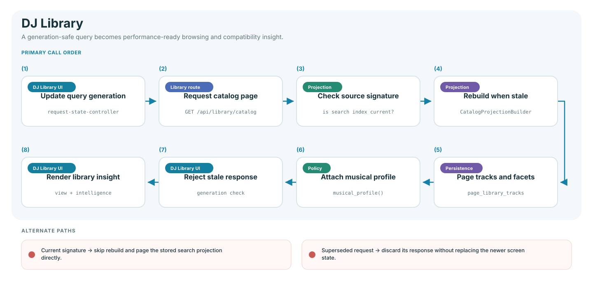
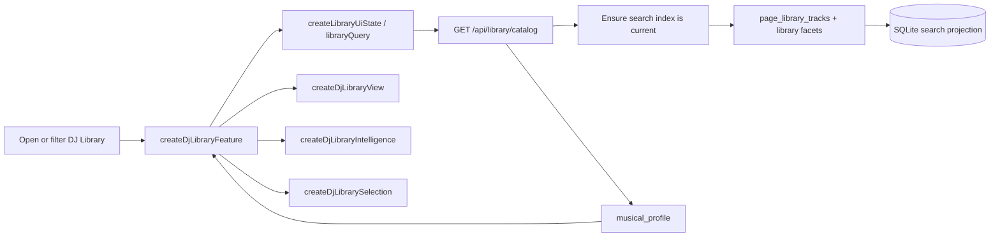
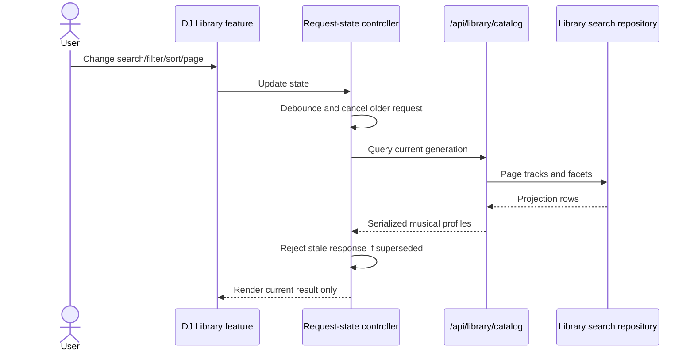

# DJ Library flow

DJ Library is the performance-oriented view of analyzed tracks. It combines the
search index, processing evidence, musical profile, compatibility rules, and
selection tools without owning catalog mutation policy.

## End-to-end read flow

The search index is a derived projection. Its source signatures are compared
before a rebuild so normal page loads do not rescan the complete library.

## Frontend modules

| Module                         | Responsibility                                                                                              |
| ------------------------------ | ----------------------------------------------------------------------------------------------------------- |
| `features/dj-library/index.js` | Load coordination, cache age, reveal actions, and composition.                                              |
| `model.js`                     | Query state, roles, key/Camelot formatting, energy, vocals, timing, and browser compatibility presentation. |
| `filters.js`                   | Filter control population and event binding.                                                                |
| `selection.js`                 | Selected-track actions and handoff into processing.                                                         |
| `view.js`                      | Grouping and rendering of catalog results.                                                                  |
| `intelligence.js`              | Recommendations and analyzed-library insights.                                                              |

Backend `library/musical_profile.py` is authoritative for normalized key,
Camelot, energy, roles, vocals, timing, confidence, and provenance. Frontend
derivations exist only as compatibility/presentation fallbacks.

## Inputs and projections

| Input                       | Produced by                              | Used for                                                 |
| --------------------------- | ---------------------------------------- | -------------------------------------------------------- |
| Completed processing jobs   | `WebJobService` and jobs repository      | Extended availability, candidates, analysis details.     |
| Downloaded-track catalog    | imports and Music Files mutations        | Stable track/file identity and metadata.                 |
| Library search index        | `CatalogProjectionBuilder` and publisher | Paginated DJ Library queries and facets.                 |
| Musical profile             | `musical_profile()`                      | Roles, energy, key, vocals, timing, evidence/provenance. |
| Manual key/BPM verification | reporting routes/repository              | Corrected values and reviewed status.                    |
| Track overrides             | reporting service                        | User-approved result overrides.                          |

## Interaction flow

Selection actions can reveal a track, play media, or hand selected source files
to the processing workspace. They do not directly modify SQLite or the managed
library.

## Compatibility versus processing

The browser's `compatibility(left, right)` helps a DJ compare neighboring tracks
interactively. It uses BPM, harmonic, energy, vocal, and timing information for
presentation. This is intentionally separate from:

- processing candidate scoring in `audioextender/analysis/`;
- Set Builder transition scoring and optimization;
- the authoritative musical-profile classification.

Changing one policy must not silently change the others.

## Failure and cache behavior

- The request-state controller aborts old queries and refuses stale responses.
- The search index is rebuilt from source signatures when its inputs change.
- Missing optional evidence is presented with confidence/provenance rather than
  fabricated certainty.
- Media/reveal actions use validated server routes; the browser does not build
  local filesystem paths.
- A failed page fetch leaves navigation functional and reports a shared error.

## Verification

- `tests/javascript/features/dj-library/dj_library_architecture.test.js`
- `tests/unit/library/test_catalog_foundations.py`
- library route cases under `tests/unit/web/`
- `tests/integration/test_manual_correction_propagation.py`
- DJ Library scenarios in `tests/browser/workflows.spec.js`
