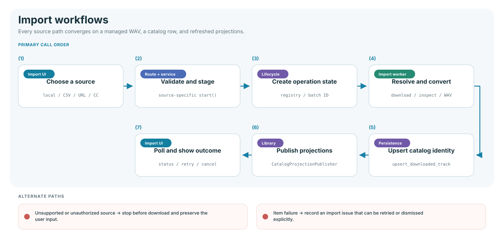

# Import workflows

Local files, playlist matches, authorized URLs, and Creative Commons sources use
different intake services. They converge only after audio is validated and ready
to become a managed catalog entry.

## Source paths

| Source           | Intake owner                                                | Background owner                |
| ---------------- | ----------------------------------------------------------- | ------------------------------- |
| Local audio      | `LocalAudioImportService.start()`                           | `LocalAudioImportService.run()` |
| Playlist CSV     | `parse_playlist_csv()` and `PlaylistMatchService.start()`   | `PlaylistMatchService`          |
| Authorized URL   | `SourceMatchingService.match()` and `ImportService.start()` | `ImportService.run()`           |
| Creative Commons | `CreativeCommonsImportService.start()`                      | `CreativeCommonsBatchWorker`    |

The browser supplies the source and presents lifecycle state. The service owns
authority checks, safe names, duplicate handling, conversion, metadata, catalog
persistence, and temporary-file cleanup.

`SourceArtworkService` applies one artwork policy to authorized imports and
later Music Files repairs. It prefers a matched Spotify cover, then provider-native
SoundCloud artwork, then a YouTube thumbnail. The first downloadable candidate
is cached under `.artwork`, embedded into the WAV, and persisted in the catalog.
Provider metadata or artwork failures never discard an otherwise valid audio
import; the queue reports artwork as unavailable and **Sync artwork** can retry it.

## Shared result

A successful import produces:

- a managed WAV under the configured music library;
- cached and embedded source artwork when a supported provider exposes it;
- one downloaded-track catalog row with stable identity and file paths;
- refreshed Music Files, DJ Library, and Set Builder projections;
- a terminal operation receipt that survives page navigation.

## Failure and recovery

- Offline storage and unsupported providers fail before expensive work starts.
- Staging is separate from the final library, so a failed conversion is never
  presented as a cataloged track.
- Item-level failures retain source, playlist, error, and attempt information.
- Retry starts a new eligible operation; dismiss resolves only selected issues.
- Polling and cancellation use the shared lifecycle vocabulary from
  `infrastructure/operation_lifecycle.py`.

## HTTP boundaries

| Family            | Start                                     | Status                                         |
| ----------------- | ----------------------------------------- | ---------------------------------------------- |
| Local audio       | `POST /api/imports/local-audio`           | `GET /api/imports/local-audio/{batch_id}`      |
| Authorized source | `POST /api/imports/authorized`            | `GET /api/imports/{import_id}`                 |
| Playlist matching | `POST /api/imports/playlist-file/matches` | `GET /api/imports/playlist-matches/{match_id}` |
| Creative Commons  | `POST /api/imports/creative-commons`      | `GET /api/imports/creative-commons/{batch_id}` |

## Verification

`tests/unit/imports/`, `tests/javascript/features/imports/`, Creative Commons
route tests, and import scenarios in `tests/browser/workflows.spec.js`.
