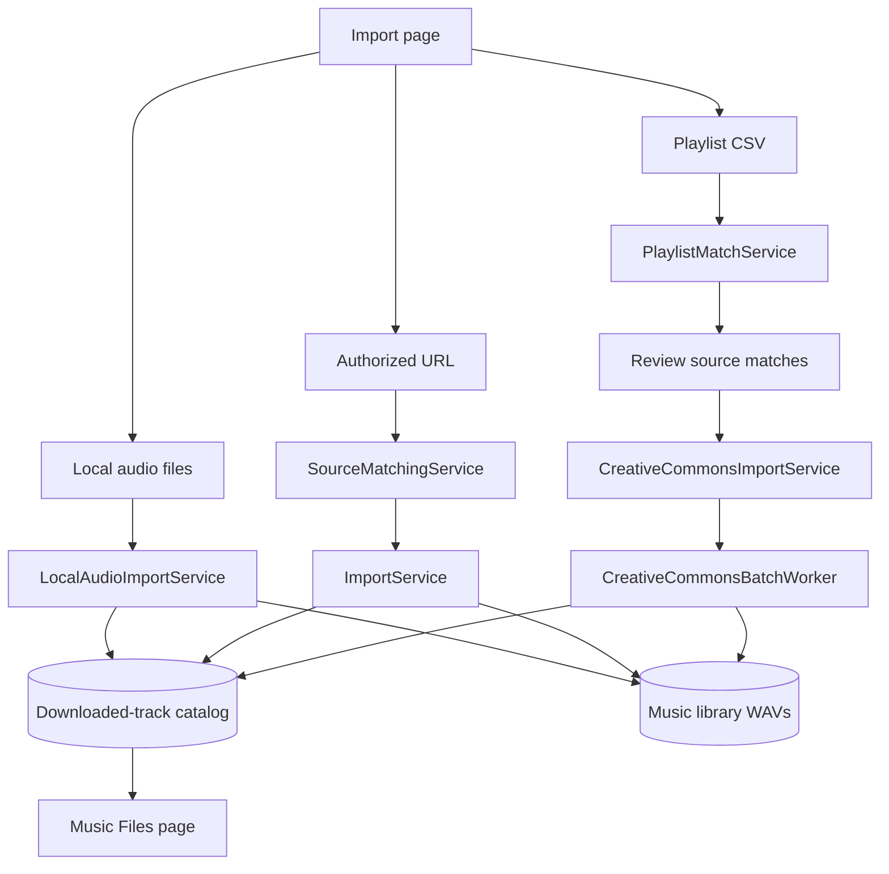
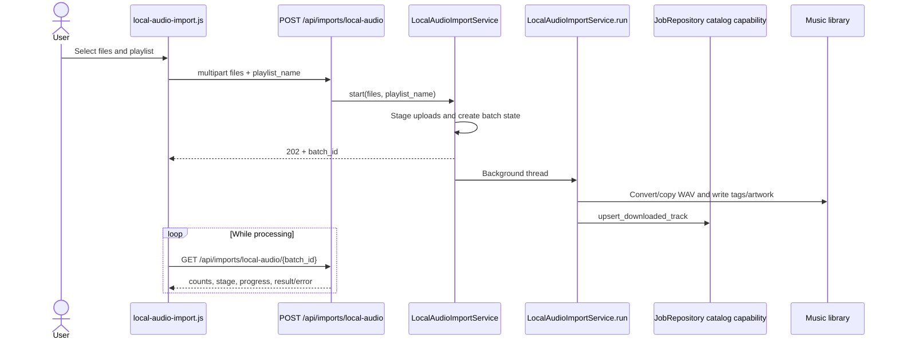
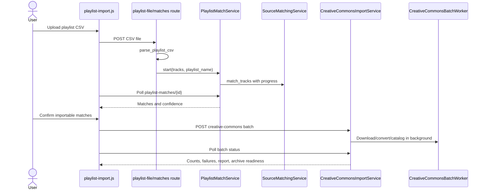

# Import workflows

The Import page supports four related but separate paths: local audio, playlist
CSV matching, authorized single-source URLs, and Creative Commons batch imports.
They share status presentation but keep different execution and recovery owners.

## Import overview

## 1. Local audio import

`createLocalAudioImportFeature()` owns staging and status presentation. The
service owns safe playlist naming, duplicate handling, conversion, metadata,
catalog persistence, and cleanup of its staging directory.

## 2. Playlist CSV and Creative Commons path

The CSV parser accepts common exported track/artist/genre columns and normalizes
them into the matching contract. `SourceMatchingService` owns provider metadata,
YouTube search, deterministic match scores, and rejection of unsupported source
shapes. The browser never decides that a match is trustworthy by itself.

Failed Creative Commons items are written as durable import failures. The
Import Issues UI calls the failure list, retry, or dismiss routes. Retry creates
a new background batch; dismissal resolves only the selected failure.

## 3. Authorized URL import

`createAuthorizedImportFeature()` first calls source matching so the user sees
the identified source. `ImportService.start()` then checks library availability,
selects the authorized provider (`youtube` or `soundcloud`), creates operation
state, and runs the provider-specific command in the background. After the WAV
is cataloged, `process_with_extender` can create and enqueue a normal processing
job; otherwise the import finishes with the unprocessed WAV in Music Files.

| Step                                      | Owner                                                      |
| ----------------------------------------- | ---------------------------------------------------------- |
| Parse URL and group multiple lines        | `sourceUrlType()`, `authorizedSourceUrls()`                |
| Fetch source metadata and suggested match | `SourceMatchingService.match()`                            |
| Validate authorized provider              | `authorized_source_provider()`                             |
| Start, cancel, status, download path      | `ImportService`                                            |
| Poll/cancel queue items                   | `AuthorizedImportQueue`, `createAuthorizedImportFeature()` |
| Catalog successful audio                  | `ImportService.run()` through repository catalog methods   |

## HTTP contracts

| Endpoint                                       | Request/model                 | Owner                                   |
| ---------------------------------------------- | ----------------------------- | --------------------------------------- |
| `POST /api/imports/source-match`               | `SourceMatchRequest`          | `SourceMatchingService.match()`         |
| `POST /api/imports/authorized`                 | `AuthorizedImportRequest`     | `ImportService.start()`                 |
| `GET /api/imports/{import_id}`                 | Operation identifier          | `ImportService.status()`                |
| `POST /api/imports/{import_id}/cancel`         | Operation identifier          | `ImportService.cancel()`                |
| `GET /api/imports/{import_id}/download`        | Completed identifier          | `ImportService.download_path()`         |
| `POST /api/imports/local-audio`                | Multipart files + playlist    | `LocalAudioImportService.start()`       |
| `GET /api/imports/local-audio/{batch_id}`      | Batch identifier              | `LocalAudioImportService.status()`      |
| `POST /api/imports/playlist-file/matches`      | CSV upload                    | parser + `PlaylistMatchService.start()` |
| `GET /api/imports/playlist-matches/{match_id}` | Match identifier              | `PlaylistMatchService.status()`         |
| `POST /api/imports/creative-commons`           | `CreativeCommonsBatchRequest` | `CreativeCommonsImportService.start()`  |
| `GET /api/imports/creative-commons/{batch_id}` | Batch identifier              | Creative Commons lifecycle              |
| `GET/POST/DELETE /api/imports/failures...`     | Failure IDs                   | `ImportIssueService`                    |

## Main models and records

| Model/record                  | Purpose                                                                                                                |
| ----------------------------- | ---------------------------------------------------------------------------------------------------------------------- |
| `AuthorizedImportRequest`     | Source URL and user-selected import metadata.                                                                          |
| `SourceMatchRequest`          | Bounded URL input for provider inspection.                                                                             |
| `CreativeCommonsMatch`        | One reviewed playlist/source match.                                                                                    |
| `CreativeCommonsBatchRequest` | Playlist name plus selected matches.                                                                                   |
| `ImportFailureRetryRequest`   | Selected durable failure IDs.                                                                                          |
| `LifecycleProjection`         | Normalized status/capability/error view across background import families.                                             |
| Downloaded-track row          | Canonical catalog record for resulting local audio, metadata, playlist membership, recording identity, and file paths. |

## Failure and recovery behavior

- An offline library fails before provider work starts.
- Unsupported URLs and provider lookup errors are expected service errors, not
  generic server failures.
- Local staging is separate from the final library; a failed conversion cannot
  masquerade as a cataloged track.
- Creative Commons failures retain source metadata, error text, attempt count,
  and playlist context for retry.
- Import status polling is cancelable and has terminal success/error behavior;
  page navigation does not create duplicate workers.

## Verification

- `tests/unit/imports/`
- `tests/unit/web/routes/test_creative_commons_routes.py`
- `tests/unit/web/test_web_app.py` import contract cases
- `tests/javascript/features/imports/`
- `tests/integration/test_stability_workflow.py`
- Import scenarios in `tests/browser/workflows.spec.js`
