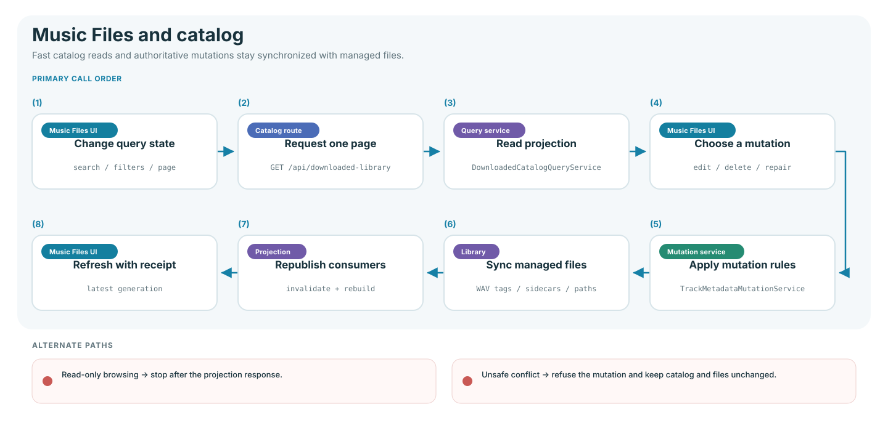
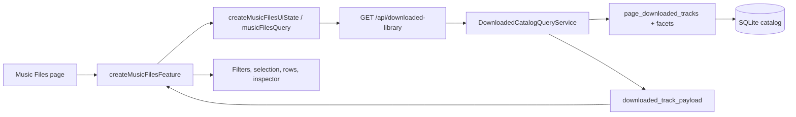
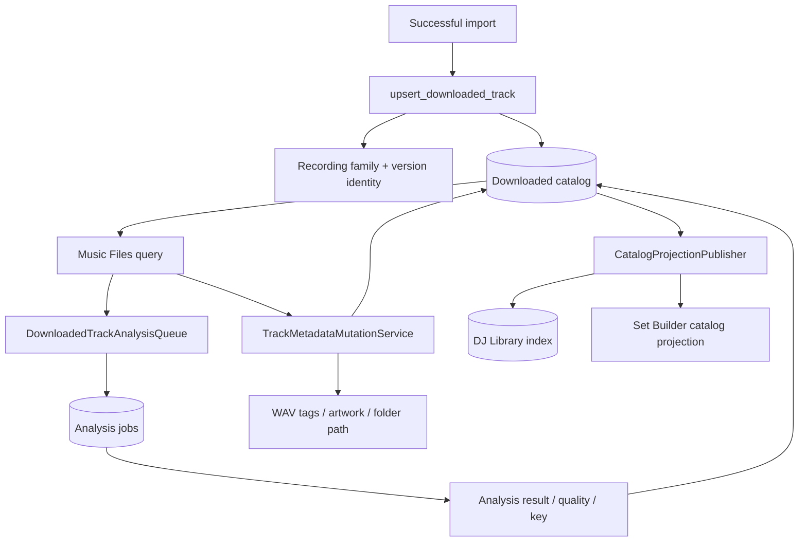
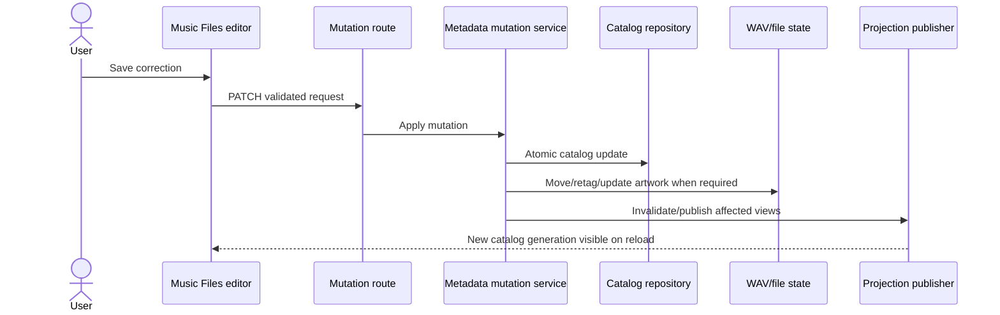

# Music Files and downloaded catalog flow

Music Files is the operational view of audio already imported into the managed
library. It reads a downloaded-track catalog, exposes media and metadata, starts
analysis, and runs explicit maintenance operations. It does not scan arbitrary
folders in the browser.

## Read path

`createRequestStateController()` owns debounce, abort, stale-response rejection,
pagination, and URL/session filter persistence. `music-files/state.js` contains
pure query/selection projections; `view.js` owns filter chips and disclosure;
`index.js` coordinates API actions and track interaction.

## Track lifecycle

## Operations and owners

| Operation                                   | Endpoint family                      | Service/domain owner                                                               |
| ------------------------------------------- | ------------------------------------ | ---------------------------------------------------------------------------------- |
| Paginated list and facets                   | `GET /api/downloaded-library`        | `DownloadedCatalogQueryService`                                                    |
| Stream audio/artwork, download, reveal, ZIP | downloaded-library delivery routes   | `DownloadedLibraryDeliveryService`, `LocalMediaService`, `ArtworkThumbnailService` |
| Analyze/reanalyze selected tracks           | `/api/downloaded-library/analyze...` | `DownloadedTrackAnalysisQueue`                                                     |
| Analyze/reanalyze current filters           | matching analysis routes             | `DownloadedAnalysisRouteService` + catalog query                                   |
| Change genre or metadata                    | downloaded-track mutation routes     | `DownloadedTrackMutationService`, `TrackMetadataMutationService`                   |
| Retag selected tracks                       | mutation route                       | `DownloadedTrackMutationService.retag()`                                           |
| Retag/rescan/sync artwork in bulk           | metadata batch routes                | `MetadataBatchService`, `BatchOperationRegistry`                                   |
| Inspect/edit descriptors                    | descriptor routes                    | `DescriptorService`                                                                |
| Find/merge/separate/link versions           | recording-family routes              | `RecordingFamilyService`, recording-family repository capability                   |
| Scan audio quality                          | audio-quality routes                 | `AudioQualityScanService`                                                          |
| Reconcile files/integrity                   | library-maintenance routes           | `LibraryMaintenanceService`                                                        |
| Delete cataloged audio                      | mutation routes                      | mutation service plus catalog/file cleanup policy                                  |

## Main request and domain models

| Model                                              | Purpose                                                                                    |
| -------------------------------------------------- | ------------------------------------------------------------------------------------------ |
| `DownloadedCatalogQuery`                           | Search, parent/detailed genre, playlist, analysis, artwork, quality, sort, and pagination. |
| `DownloadedTracksRequest`                          | A bounded list of selected track IDs.                                                      |
| `DownloadedGenreRequest`                           | Selected IDs plus normalized genre/category.                                               |
| `DownloadedMetadataRequest`                        | Validated title, artist, genre, playlist, and metadata fields for one track.               |
| `DownloadedAnalysisFilterRequest`                  | Filter set for analyze/reanalyze-matching.                                                 |
| `TrackMetadataUpdate`                              | Service-level atomic metadata mutation.                                                    |
| `TrackDescriptor` / `DescriptorUpdateRequest`      | Musical identity descriptor values and provenance.                                         |
| `DuplicateMergeRequest` / `TrackFamilyLinkRequest` | Recording-family mutation contracts.                                                       |

## Recording identity and duplicate behavior

`library/recording_identity.py` normalizes artist/title identity, detects common
version kinds, and produces canonical recording keys. Persistence assigns stable
family/version identifiers during catalog upsert. The recording-family service
then supports:

- suggested duplicates;
- merging a duplicate into a survivor;
- marking a track as intentionally separate;
- linking a remix/edit/version to a family;
- unlinking a mistaken association.

Set Builder consumes the same recording-family identity to avoid putting two
versions of the same recording in one plan unless the user deliberately chooses
an alternative version.

## Mutation propagation

A metadata correction is not complete when only one row changes. The mutation
service coordinates the catalog record, playlist membership, local file tags,
related job metadata, and projection invalidation. The projection publisher then
refreshes the DJ Library search index and Set Builder catalog view.

## Failure and safety behavior

- Media paths are resolved through the catalog and validated against allowed
  roots before delivery.
- Bulk operations are cancellable/retryable and report per-item failures.
- File reconciliation and integrity repair are separate: inspection does not
  silently mutate the library.
- Track deletion and duplicate merge are explicit destructive operations with
  service-level policy, not direct browser filesystem access.
- Manual descriptor protection prevents later inference from overwriting a
  reviewed identity.

## Verification

- `tests/unit/library/`
- Downloaded-library, mutation, recording-family, metadata-batch, descriptor,
  and maintenance route tests under `tests/unit/web/routes/`
- `tests/javascript/features/music-files/`
- Catalog stability cases in `tests/integration/test_stability_workflow.py`
- Music Files browser workflows in `tests/browser/workflows.spec.js`
