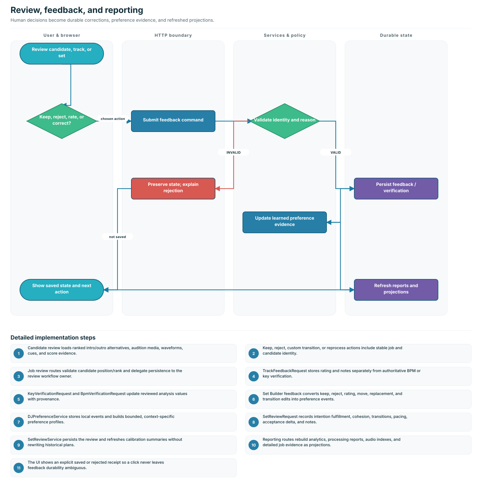
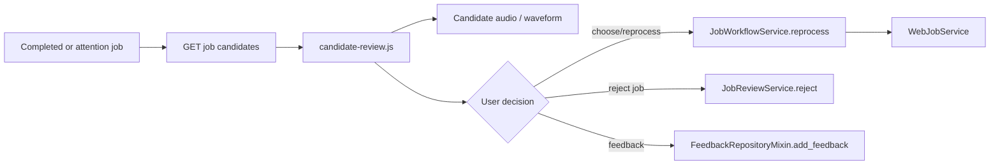
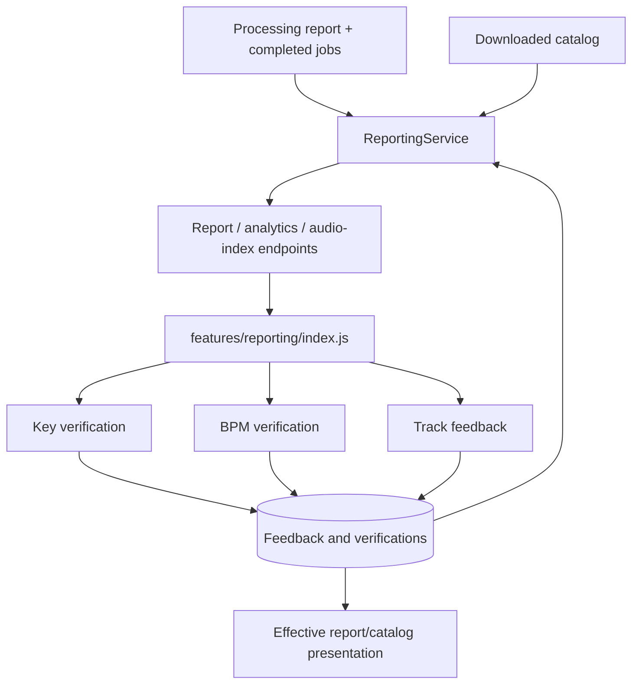
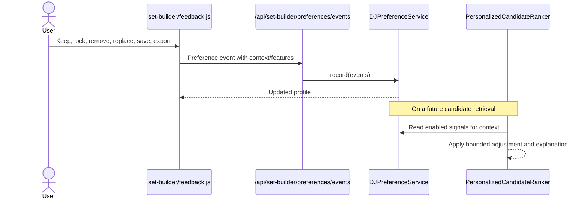

# Review, feedback, and reporting flows

The application has three feedback families with different purposes:

1. processing candidate review chooses or critiques generated intro/outro edits;
2. report corrections verify analyzed metadata such as BPM and key;
3. Set Builder review teaches local ranking preferences and evaluates a plan.

They should not be treated as one generic rating table.

## Processing candidate review

`FeedbackRequest` records position, decision, reason, notes, selected rank, and
optional candidate score context. Reprocessing creates a new queue execution
through the normal workflow instead of editing an already completed result in
place.

## Analysis corrections and reports

| Contract                 | Purpose                                                      |
| ------------------------ | ------------------------------------------------------------ |
| `TrackFeedbackRequest`   | Track-level rating and notes from the analysis/report view.  |
| `KeyVerificationRequest` | Reviewed key value, optional confidence, notes, and removal. |
| `BpmVerificationRequest` | Reviewed BPM value, optional confidence, notes, and removal. |
| `OverrideRequest`        | Compatibility override record for a processed source.        |

Corrections are stored separately from raw analyzer evidence. Presentation
layers apply reviewed values while retaining provenance, so reanalysis and
manual verification can be distinguished.

## Set Builder preference events

Immediate actions such as keep, lock, save, export, remove, and replacement are
converted into `PreferenceEventRequest` records by `feedback.js`. The event
contains the track ID, planning context, and normalized feature values. The
event is idempotent when the browser supplies the same event ID.

`DJPreferenceService` stores events in the local preference JSON store and
builds context-specific preference profiles. `PersonalizedCandidateRanker`
turns active signals into bounded ranking adjustments; it does not override
hard eligibility, file availability, recording uniqueness, required/excluded
rules, or final validation.

Users can pause personalization, reset the profile, or dismiss one signal. Raw
events and summarized active signals remain visible through the preference API.

## Full Set Builder review

`SetReviewRequest` records:

- set/revision identity and planning context;
- overall accept/reject/unreviewed decision and notes;
- per-track decision, reason, match tier, technical score, preference adjustment,
  rank delta, and features;
- 1–5 transition ratings and transition features;
- plan evaluation and AI-versus-baseline comparison evidence.

`SetReviewService.record()` persists the review and updates calibration reports.
Accepted/rejected track entries are also converted to preference events by the
review router, keeping durable review evidence and ranking signals consistent.

## Reporting outputs

| Endpoint                                   | Result                                        |
| ------------------------------------------ | --------------------------------------------- |
| `GET /api/analytics`                       | Queue/catalog summary metrics.                |
| `GET /api/report`                          | Processing report projection.                 |
| `GET /api/report-audio-index`              | Audio availability index for report playback. |
| `GET /api/library/jobs/{id}/details`       | Full job evidence used by analysis details.   |
| `GET/POST /api/report-feedback`            | Report-level feedback document.               |
| `GET/PUT/DELETE /api/key-verifications...` | Manual key corrections.                       |
| `GET/PUT/DELETE /api/bpm-verifications...` | Manual BPM corrections.                       |
| `GET /api/feedback`                        | Job/track feedback history.                   |
| `GET/POST/DELETE /api/set-builder/reviews` | Set review/calibration records.               |

## Failure and trust behavior

- A rating never rewrites raw audio analysis silently.
- Preference learning changes ranking only; deterministic validation remains
  authoritative.
- Reviewed BPM/key values preserve their source and can be removed.
- Reprocessing creates normal queue state and artifacts, so it benefits from the
  same cancellation, recovery, and error contracts as a new job.
- Report caches must be invalidated after relevant persistence changes.

## Verification

- `tests/unit/set_builder/test_set_review_service.py`
- `tests/unit/set_builder/test_set_preference_learning.py`
- `tests/unit/reporting/`
- `tests/unit/web/routes/test_reporting_routes.py`
- candidate review and Set Builder JavaScript tests
- reporting/review workflows in `tests/browser/workflows.spec.js`
