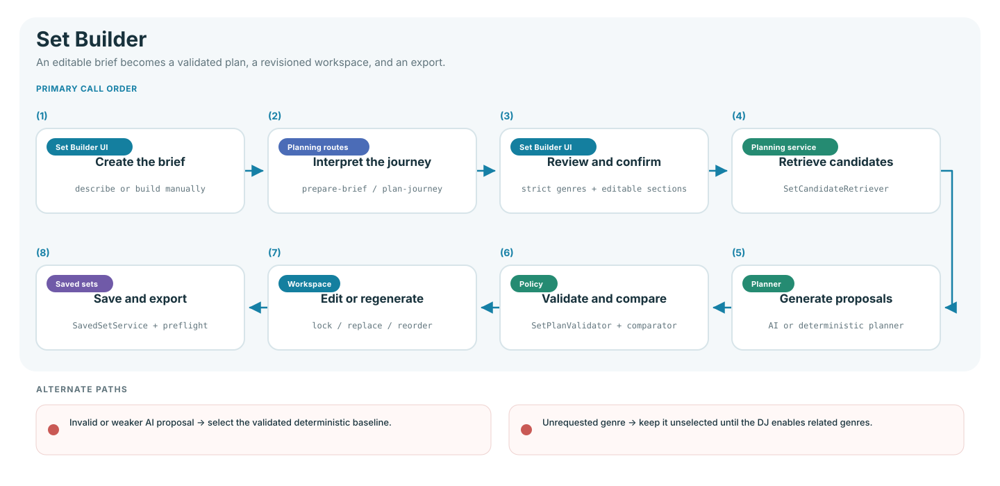

# Set Builder flow

Set Builder supports interpreted briefs, configured journeys, and direct
track-by-track curation. AI can propose; catalog safety, recording identity,
required tracks, and final validation remain deterministic authority.

## Authoring paths

| Path                  | What the user controls                                     | Planning result                                       |
| --------------------- | ---------------------------------------------------------- | ----------------------------------------------------- |
| Describe what I want  | Intention text, then the interpreted brief and journey     | AI-assisted interpretation with editable output       |
| Configure the journey | Genres, energy, journey, constraints, and track rules      | Direct structured brief with the same validation path |
| Curate track by track | Every selected track and its position in the running order | Empty workspace filled directly from the catalog      |

The first two paths produce the same planning request. The browser never sends the full
database to a model; it sends a bounded set of validated catalog candidates.
The catalog response also carries a server-built genre vocabulary covering
canonical genres, detailed aliases, playlist identities, and cultural
descriptors. Brief endpoints prefer this current server vocabulary over a stale
browser copy, and the browser merges the same authority into its local policy.
Restarting after a catalog-schema revision rebuilds this projection
automatically; audio analysis does not need to be rerun.

Track-by-track curation bypasses plan generation but not plan integrity. Its
inline catalog searches the complete track identity: title, artist, parent and
detailed genres, durable descriptors, playlist/crate identity, roles, vibes,
key, BPM, energy, vocals, and timing. Multiple keywords are ranked across those
sources; **Require every keyword** turns the query into a narrow intersection.
Every result shows the evidence that matched, including the source playlist,
and retains shared seekable playback. The catalog browser is normal document
flow—not a fixed overlay—so it cannot cover the running order or workspace
controls at desktop or mobile widths.

Adding a manual result uses the same recording-family boundary as generated
plans. Once one version occupies the running order, every other original,
remix, edit, or duplicate import in that song family is marked unavailable.
Those versions remain reachable through the existing explicit Alternatives
workflow. Reorder, Undo/Redo, transition health, review, save/load, and export
continue through their existing owners. The persisted compatibility value is
`manual-curation`; loading it restores the same authoring workspace.

An exact genre request is strict by default. For example, `Latin Techno` may
change energy, character, and purpose across sections, but it cannot silently
become Latin Pop, R&B, House, or Amapiano. Model-proposed catalog neighbors are
retained only as unselected suggestions. The DJ must enable **Allow related
genres** and add a suggestion deliberately before it enters the journey.
Specific catalog names also take precedence over nested parent names: writing
`Latin Techno` does not independently request `Techno` unless the brief names
Techno elsewhere. Both the server and the browser reconcile AI output against
the written brief, so a cached or older proposal cannot bypass this boundary.

Playlist names contribute lower-confidence musical-identity tags without
rewriting canonical genres. These tags are derived from the catalog's current
genre vocabulary rather than a fixed alias list. Compound catalog identities
match playlist words in any order and accept only conservative one-letter word
variants, so both `LATIN_bounce_TECHNO_Rave_Edition` and `Techno_Latino` can
support the catalog identity `Latin Techno`. A track's canonical genre may
remain Reggaeton while it qualifies through that playlist evidence.
Direct genre matches rank first; playlist-supported matches are labeled as
identity evidence and name the source playlist in the planning explanation.
Catalog-derived cultural descriptors are also available as planning identities.
For example, an `Indian / South Asian` descriptor lets an Indian party brief
find suitable tracks even when their canonical genre is Bollywood, Bhangra, or
another catalog label. This does not rewrite the track's genre.

Negative and positional language is enforced after AI interpretation. A phrase
such as `No rap` becomes a hard catalog exclusion and is removed from requested
genres, while `Genre A to warm up` assigns the nearest preceding catalog genre
to the opening and moves it before the remaining genre sequence. The interpretation
stores that assignment separately as an opening-only genre: it does not become
a persistent core genre or leak into Build and Closing. The policy has no
House/Techno allowlist: Bachata into Salsa, Amapiano into Afro House, or any
other catalog-backed pair follows the same rule. An opening-only genre receives
25% of the fallback journey while the persistent direction receives the remaining
75%. The same positional policy repairs AI proposals and validates manual journey
edits. `Warm up with Genre A` applies the same rule to the catalog genre following
the cue. Explicit
`high energy` language establishes a minimum energy
floor; `throughout`, `all around`, or `start to finish` applies the stronger
floor to every journey section. These rules resolve through the current catalog
vocabulary and are not hard-coded to individual genre names.

AI-created journeys begin in **Needs confirmation** state. Editing a section,
changing genre expansion, or changing the prompt returns the journey to that
state. **Confirm journey** validates 100% duration coverage, non-empty genres,
and the strict genre boundary; the action is disabled and the affected genres
are named while a correction is required. Only then can track planning begin. Loaded saved
plans retain their already-reviewed journey for backward compatibility.

Track selection is a separate decision from brief authoring:

| Track selection | What happens                                                                    |
| --------------- | ------------------------------------------------------------------------------- |
| AI curated      | AI ranks and orders a bounded candidate pool; deterministic validation follows  |
| Rules-based     | Local genre, BPM, key, energy, and constraint scoring chooses and orders tracks |
| Chosen by you   | The DJ searches identity evidence, previews audio, and inserts each track         |

The interface presents these two choices directly. Legacy saved-set values
(`ai-planned`, `interpreted`, `classic`, and `manual-curation`) remain an internal compatibility
contract and are migrated into the two-part workflow when a plan is loaded.

## Planning owners

| Owner                                                             | Responsibility                                                                   |
| ----------------------------------------------------------------- | -------------------------------------------------------------------------------- |
| `BriefPreparationService` / `IntentionPlanner` / `JourneyPlanner` | Interpret, schema-check, and enforce explicit genre expansion authority          |
| `SetCandidateRetriever`                                           | Apply genre, availability, mixing, lock, descriptor, and playlist-identity rules |
| `AITrackPlanner`                                                  | Produce bounded AI and deterministic proposals                                   |
| `SetPlanValidator`                                                | Reject invented, duplicate, unavailable, excluded, or misplaced tracks           |
| `journey-allocation.js`                                           | Reserve browser-planned positions for each confirmed section and detect scarcity |
| Plan comparator                                                   | Select the strongest safe proposal and disclose fallback                         |
| Set Builder workspace                                             | Edit, lock, replace, reorder, undo/redo, and regenerate                          |
| `manual-curation.js`                                              | Search catalog identity evidence and insert explicit track choices               |
| `track-identity-store.js`                                         | Recover browser-only identity terms without owning catalog descriptors           |
| `SavedSetService`                                                 | Persist the versioned brief, plan, locks, transitions, and receipt               |

## Revision and regeneration rules

- A lock protects the track identity and its journey section.
- Regeneration changes only eligible unlocked positions.
- `base_plan_revision` links the new draft to its parent.
- Failure restores the complete previous revision, including transitions.
- Undo/redo operates on atomic plan snapshots.
- Export preflight verifies every local audio path before writing a playlist.

## Track decisions and replacement

The compact row exposes listening and quick structural actions. Detailed track
feedback lives in the fixed inspector so the running order remains scannable.

1. **Keep** writes one idempotent `keep` preference event and displays a saved
   receipt. It does not lock the track.
2. **Reject & replace** collects an optional reason and a required scope:
   version-only or the complete recording family.
3. `track-decision-store.js` persists the event before the running order is
   mutated. The event carries the track, recording family, set, revision,
   context, reason, and feature evidence.
4. `track-rejection.js` excludes the selected scope, searches the existing
   hard-eligible pool, rejects occupied recording families, and ranks remaining
   candidates using the current section and adjacent transition policy.
5. The workspace inserts the validated replacement into the same journey
   section, clears affected transition overrides, advances the revision, and
   shows **Replaced** plus a saved-feedback receipt.
6. Undo restores the complete snapshot and calls
   `DELETE /api/set-builder/preferences/events/{event_id}`. Redo records the same
   stable event again. Reconciliation is serialized so rapid Undo/Redo cannot
   reorder the durable writes.

Locked or required tracks cannot enter this workflow until their protection is
removed. When no valid replacement exists, the rejected track stays visible
with a retry action and blocks Save/Export. This is an explicit unresolved state,
not a silently accepted track or a fake catalog placeholder. A no-candidate
retry does not create another event or empty revision; it reuses the saved scope.

## Trust and fallback

- Ollama being unavailable does not disable deterministic planning.
- Invalid or weaker AI output is replaced by the validated deterministic plan.
- Recording-family duplicates cannot occupy two set positions.
- The same pure recording-family policy guards browser planning, manual edits,
  snapshot restoration, saved-set loading, durable persistence, regeneration,
  and both playlist export formats.
- Explicitly locked or required versions outrank unprotected versions. Two
  protected versions in one family are reported as a rule conflict so the DJ
  can choose which version remains.
- Other versions of a recording may be shown as explicit alternatives.
- Song-family inference is catalog-wide and metadata-driven: canonical titles,
  explicit version/feature labels, stable source IDs, exact audio fingerprints,
  and shared named artist credits converge originals, edits, and remixes without
  a song-specific alias list. Unrelated covers with the same title stay separate.
- App startup safely repairs unlocked legacy family assignments, so this identity
  improvement does not require rerunning audio analysis. Manual links and
  **Keep as separate recording** remain authoritative.
- Exact genre requests never expand through scarcity fallback; the DJ is asked
  to allow related genres explicitly instead.
- Rules-based planning selects against the genre list for the position's
  confirmed journey section. Transition optimization may reorder tracks only
  inside that section, never across its boundaries.
- Every selected row shows the evidence class for its section identity. Direct
  catalog genres and descriptors are verified evidence; playlist/crate identity
  is labeled as estimated and the source playlist is named under **Why this
  track**. A generic parent tag alone does not qualify as a more specific catalog
  identity—for example, House alone is not Afro House and Techno alone is not
  Latin Techno.
- If a strict section does not have enough unique analyzed matches, generation
  stops with the section name, required count, and available count. The existing
  plan remains unchanged.
- Plan health is an explanation signal; hard validation is the release gate.

## Verification

`tests/unit/set_builder/`, `tests/javascript/features/set-builder/`, Set Builder
route tests, and Set Builder scenarios in `tests/browser/workflows.spec.js`.
