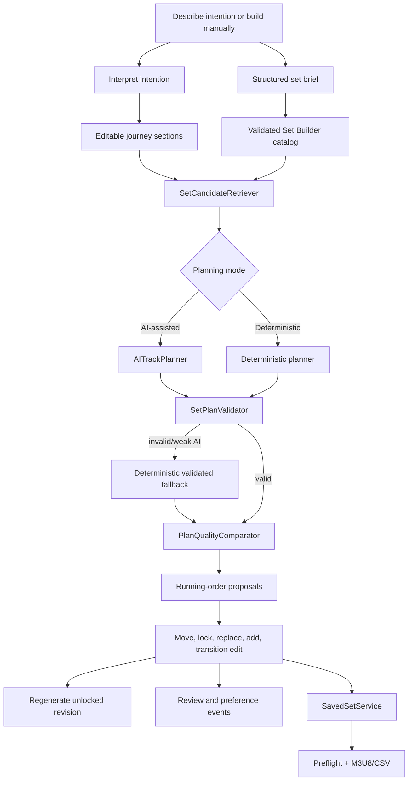
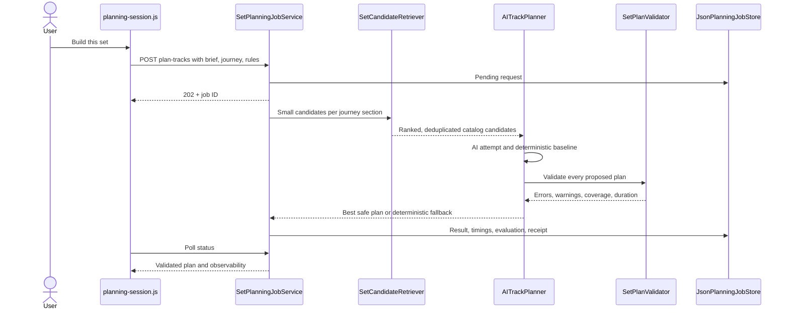
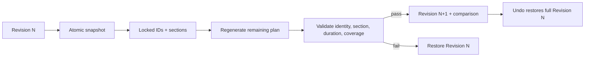

# Set Builder flow

Set Builder turns either a natural-language intention or manually selected
constraints into an editable, validated running order. Local AI is optional:
deterministic planning remains available, and AI output is never allowed to
bypass catalog, identity, availability, or plan validation.

## Complete workflow

## 1. Catalog and brief preparation

`GET /api/set-builder/catalog` returns a server-built projection of analyzed
tracks. It includes stable catalog/recording identity, file availability, BPM,
key, energy, genres, descriptors, vocals, duration, and evidence used by
planning. The browser does not send the unrestricted database to a model.

Two authoring paths meet at the same structured brief:

| Path                 | Browser owner                                 | Backend owner                                                                      |
| -------------------- | --------------------------------------------- | ---------------------------------------------------------------------------------- |
| Describe what I want | `createSetIntentionController()`              | `BriefPreparationService`, `IntentionPlanner`, `JourneyPlanner`                    |
| Build manually       | `createSetWorkflowController()`, `setBrief()` | Browser validates controls; server planning still validates candidates and output. |

`POST /interpret-intention` converts text into hard requirements, preferences,
limits, and genre/identity terms. `POST /plan-journey` produces editable sections
with duration, energy, genre, character, and purpose. `POST /prepare-brief`
combines those provider calls where supported. Provider output is schema-checked
and sanitized against catalog vocabulary; an offline journey remains available.

## 2. Candidate retrieval and track planning

Candidate retrieval enforces hard filters, exclusions, required/locked tracks,
recording-family uniqueness, file availability, bounded candidate counts, and
journey-section eligibility. Scarce genres expand through identity, adjacent,
bridge, then flow-only tiers, with the relaxation disclosed in the result.

The model receives only compact validated candidates. `SetPlanValidator` rejects
invented IDs, duplicate tracks/recordings, missing required or locked tracks,
excluded tracks, unavailable files, invalid sections, moved section locks,
journey gaps, and broken duration/count targets.

## Planning models and receipts

| Model/record              | Purpose                                                                                                                 |
| ------------------------- | ----------------------------------------------------------------------------------------------------------------------- |
| `SetIntentionRequest`     | Natural-language brief plus bounded catalog vocabulary.                                                                 |
| `SetJourneyRequest`       | Intention request plus interpreted structure and duration.                                                              |
| `SetCandidatePoolRequest` | Journey, hard rules, locked sections, and candidate limits.                                                             |
| `SetTrackPlanningRequest` | Full asynchronous planning request, target length/count, locks, and base revision.                                      |
| Candidate pool            | Per-section candidates with relevance tier, reasons, identity, technical evidence, and eligibility.                     |
| Planning job record       | Pending/running/completed/failed/canceled state stored in `set_planning_jobs.json`.                                     |
| Planning receipt          | Provider/model, attempts, validation/repair, comparator decision, fallback, timings, evaluation, and revision ancestry. |
| Plan revision             | Stable draft/revision ID, number, parent ID, timestamp, and source.                                                     |

## 3. Plan editing and transition work

| Frontend module           | Responsibility                                                          |
| ------------------------- | ----------------------------------------------------------------------- |
| `index.js`                | Feature composition, brief/candidate coordination, history integration. |
| `planning-session.js`     | AI/deterministic generation, proposals, polling, receipt.               |
| `planning-request.js`     | Pure journey/count/ID/locked-section request derivation.                |
| `plan-view.js`            | Running-order rendering and track edit interactions.                    |
| `commands.js`             | Snapshot-based undo/redo checkpoints.                                   |
| `transition-editor.js`    | Transition scoring, preview, cue candidates, fades, optimization.       |
| `workspace-shell.js`      | Compact workspace, selected-track inspector, sticky actions.            |
| `version-alternatives.js` | Alternative versions from the same recording family.                    |
| `recording-identity.js`   | Stable IDs and recording-level deduplication.                           |
| `feedback.js`             | Track/transition review and local preference signals.                   |

The transition editor can recommend and audition a mix technique, but it does
not change the server-side catalog or processing analysis. Plan health is a
presentation/evaluation signal; hard validation remains a separate gate.

## 4. Regenerate with locks

Locking a track protects both its identity and journey section. Regeneration
sends the current revision as `base_plan_revision` and a
`locked_track_sections` map. Candidate retrieval emits a locked track only for
that section; AI instructions, deterministic section targets, and final
validation all enforce the same constraint.

`regeneration.js` compares stayed/added/removed tracks and locked preservation.
The entire operation is one undoable edit, including transition settings,
revision identity, and planning receipt.

## 5. Save and export

`SavedSetService` persists versioned set records through system-state
persistence. The browser keeps a recovery cache but the backend record is
authoritative. Saving retains the brief, plan, locks, transitions, review state,
planning receipt, and revision identity.

Before M3U8 export, `/export-preflight` verifies every local audio path. The
server can also write a playlist under the configured music library's
`_Playlist` directory. CSV export is assembled by the browser from the same plan
and explanation data.

## Failure and fallback behavior

- Ollama being unavailable does not stop the app or deterministic Set Builder.
- Intention/journey provider failures use explicit offline behavior or an error;
  they do not silently fabricate catalog facts.
- AI track planning is bounded, cancelable, retryable, and durably observable.
- Invalid or lower-quality AI plans are rejected in favor of the validated
  deterministic baseline.
- A regeneration failure restores the exact previous revision.
- Missing export files fail preflight before a misleading playlist is written.

## Verification

- `tests/unit/set_builder/`
- Set Builder route tests under `tests/unit/web/`
- `tests/javascript/features/set-builder/`
- Set Builder browser scenarios in `tests/browser/workflows.spec.js`
- `docs/architecture/set-builder-workflow-redesign.md`
- `docs/architecture/musical-policy-ownership.md`
