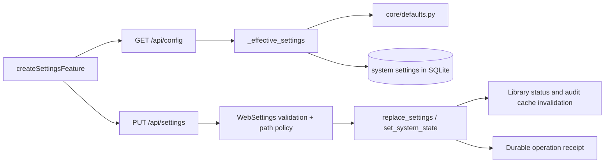
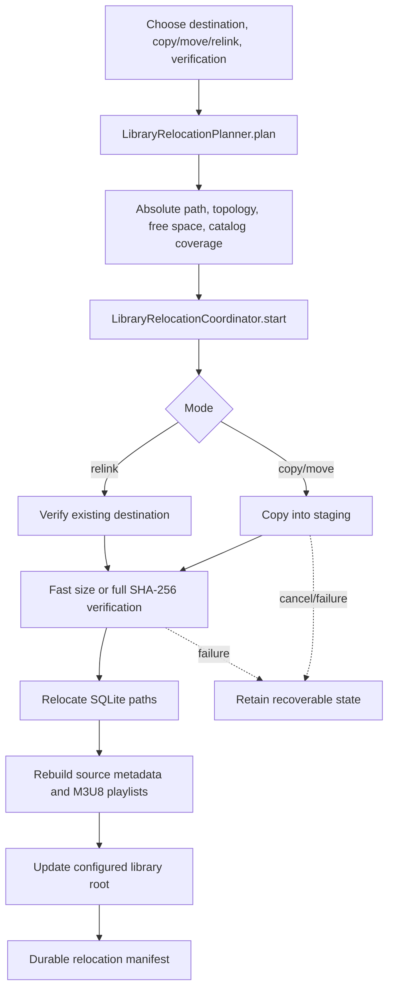
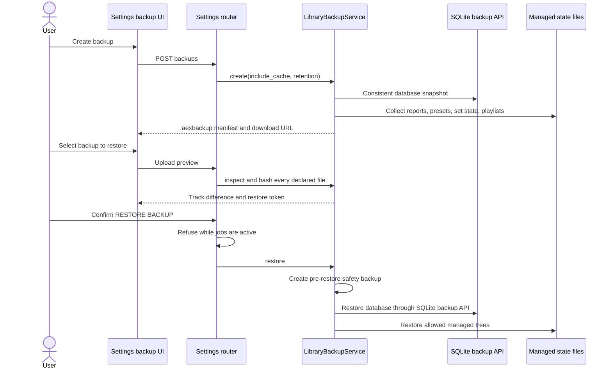

# Settings, storage, and operational flows

Settings owns persistent application preferences and the safety-sensitive
operations around library availability, relocation, backups, storage cleanup,
and diagnostics.

## Settings read/write flow

`WebSettings` is the HTTP model. Shipped defaults live in
`audioextender/core/defaults.py`; only overrides are saved. The response returns
defaults, effective values, stored overrides, and an operation receipt explaining
what changed and whether it survives restart.

## Library availability and health

The Settings page distinguishes location from health:

- **library status** checks the configured path, managed identity, writable
  state, and location summary;
- **library health** summarizes catalog/file/tag/artwork consistency;
- **verify library** refreshes health evidence explicitly;
- **audio-quality scan** analyzes local file quality in a background batch;
- **integrity scan/repair** inspects and optionally repairs catalog/file gaps.

These reads are cached briefly because large external drives can be slow. Any
location or relevant catalog change invalidates the corresponding cache.

## Relocation flow

| Class                          | Responsibility                                                                                                |
| ------------------------------ | ------------------------------------------------------------------------------------------------------------- |
| `LibraryRelocationPlanner`     | Reject unsafe layout, unavailable source, nonempty destination, missing relink files, and insufficient space. |
| `LibraryFileTransferService`   | Resumable file copy into staging with cancel checks.                                                          |
| `LibraryRelocationVerifier`    | Size verification or full content hashing.                                                                    |
| `LibraryMetadataRelinker`      | Rebuild source sidecars, playlists, and managed-library identity.                                             |
| `LibraryRelocationCoordinator` | Durable manifest, worker thread, progress, cancellation, rollback, and restart recovery.                      |

The coordinator marks an operation interrupted by application shutdown as
failed/retryable rather than pretending it is still running.

## Backup and restore flow

The archive manifest records format version, source library path, track count,
file size, and SHA-256 for every file. Extraction rejects unsafe paths. A restore
always creates a pre-restore backup first and invalidates report/catalog caches.

## Storage and cleanup

`SettingsRouteService.storage_inventory()` reports known managed roots rather
than scanning or deleting arbitrary locations. `/api/settings/storage/cleanup`
accepts only a named target. Full application cleanup requires a confirmation
phrase, preserves the database/persistent settings needed by its contract, clears
process-local import registries, and recreates expected workspace directories.

For source-checkout housekeeping, use
`scripts/maintenance/clean_workspace.py`; it is separate from application data
cleanup.

## Diagnostics

`PerformanceDiagnostics.middleware` records bounded request timings and failure
counts. `GET /api/diagnostics/performance` returns count, average, p95, maximum,
recent slow operations, and waveform/artwork cache hit rates. Diagnostics are
process-local measurements, not musical or catalog state.

## Important models

| Model                       | Purpose                                      |
| --------------------------- | -------------------------------------------- |
| `WebSettings`               | Validated persistent settings.               |
| `LibraryRelocationRequest`  | Destination, mode, and verification level.   |
| `BackupCreateRequest`       | Cache inclusion and retention.               |
| `BackupRestoreRequest`      | Preview token and exact confirmation phrase. |
| `StorageCleanupRequest`     | One allowlisted managed storage target.      |
| `ApplicationCleanupRequest` | Explicit full-cleanup confirmation.          |
| `LifecycleProjection`       | Normalized relocation and batch status.      |

## Verification

- settings/backup/relocation tests under `tests/unit/web/` and `tests/unit/library/`
- `tests/unit/library/test_relocation.py`
- `tests/unit/web/routes/test_settings_status_performance.py`
- `tests/integration/test_stability_workflow.py`
- Settings and external-drive browser scenarios in `tests/browser/workflows.spec.js`
- `docs/guides/operator-guide.md`
