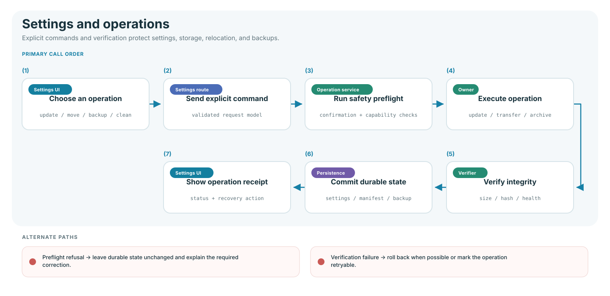

# Settings and operations flow

Settings operations use explicit commands, safety checks, verification, and
receipts so storage or configuration changes cannot become silent partial work.

## Operation owners

| Operation             | Owner                          | Safety boundary                                               |
| --------------------- | ------------------------------ | ------------------------------------------------------------- |
| Settings update       | Settings route service         | Persist validated overrides only                              |
| Library health/status | Library status services        | Distinguish configured, online, writable, and cataloged state |
| Relocation            | `LibraryRelocationCoordinator` | Plan, stage, verify, relink, then commit                      |
| Backup/restore        | `LibraryBackupService`         | Hash allowlisted files and create a pre-restore backup        |
| Storage cleanup       | Settings cleanup service       | Accept named managed targets only                             |
| Diagnostics           | `PerformanceDiagnostics`       | Bounded process-local timing and cache statistics             |

## Relocation guarantee

The planner checks topology, capacity, conflicts, and relink prerequisites. Files
are copied into staging and verified before authoritative paths change. The
durable manifest supports progress, cancellation, rollback, and restart recovery.

## Backup and cleanup guarantee

- Backup uses SQLite's consistent backup API and records SHA-256 hashes.
- Restore rejects unsafe archive paths, requires exact confirmation, and creates
  a safety backup first.
- Cleanup cannot target arbitrary filesystem paths.
- Full application cleanup uses a separate confirmation phrase.
- Every failure either rolls back or leaves a retryable, inspectable record.

## Verification

Settings, backup, cleanup, and relocation tests under `tests/unit/web/` and
`tests/unit/library/`, plus external-drive scenarios in
`tests/browser/workflows.spec.js`.
