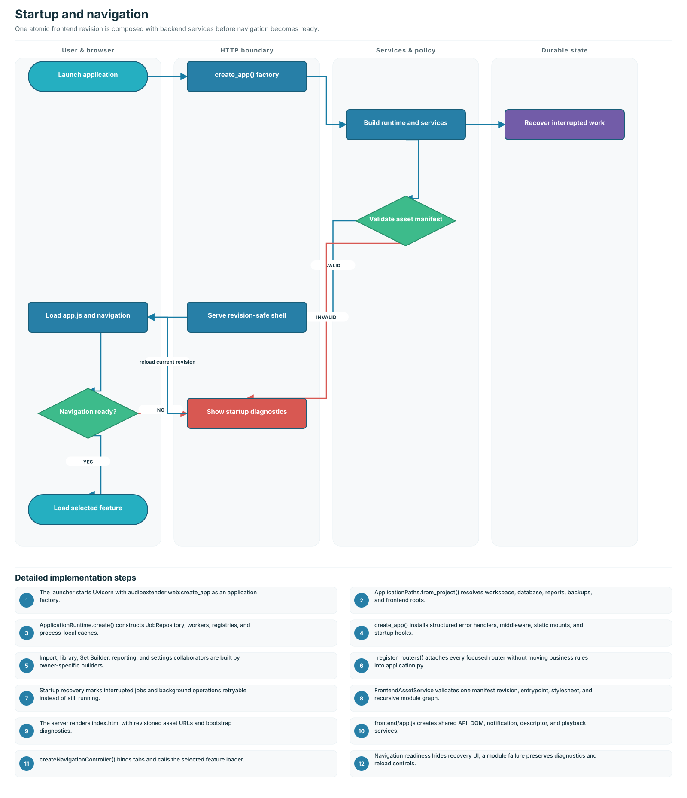
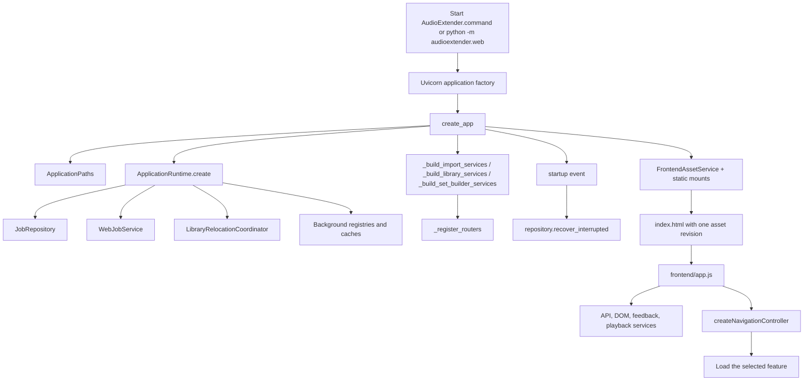
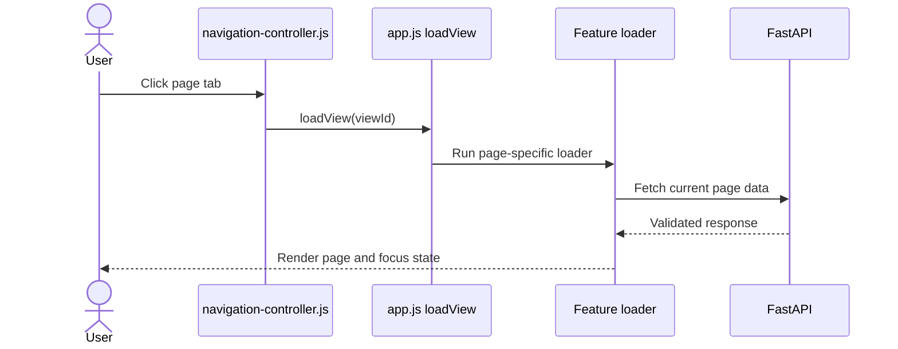

# Startup and navigation flow

This flow covers launching the web application, constructing backend services,
serving a revision-safe frontend, and loading a page when a navigation tab is
selected.

## End-to-end flow

`audioextender.web.application.app` is a `LazyApplication`: importing the module
does not construct the repository or run recovery. The ASGI app is resolved on
first use, while the normal launcher explicitly uses `create_app` as a factory.

## Backend ownership

| Component                         | Responsibility                                                                                                                                |
| --------------------------------- | --------------------------------------------------------------------------------------------------------------------------------------------- |
| `ApplicationPaths.from_project()` | Resolves the project, workspace, database, report, backup, frontend, and default library paths.                                               |
| `ApplicationRuntime.create()`     | Creates the repository, processing queue, relocation coordinator, and durable Creative Commons registry without running startup side effects. |
| `create_app()`                    | Builds services, installs error handlers/middleware, mounts assets, registers routers, and attaches the startup handler.                      |
| `_build_import_services()`        | Composes authorized, local, playlist, source-match, Creative Commons, and import-failure collaborators.                                       |
| `_build_library_services()`       | Composes catalog, mutation, analysis, maintenance, job, reporting, and settings collaborators.                                                |
| `_build_set_builder_services()`   | Composes intention, journey, candidate, validation, planning, saved-set, preference, and review collaborators.                                |
| `_register_routers()`             | The single HTTP registration boundary. It does not own business rules.                                                                        |
| `FrontendAssetService`            | Reads `frontend/asset-manifest.json`, validates the entrypoint/stylesheet, and renders one atomic asset revision into the HTML shell.         |

## Browser ownership

`frontend/app.js` is the composition root. It creates shared services and each
feature, then exposes feature loaders to `createNavigationController()`.

The browser calls `window.__djAppMarkNavigationReady()` only after the entry
module and navigation controller have loaded. The bootstrap shell can therefore
distinguish a functional application from a stylesheet-only or partially linked
module graph.

## Main models and state

| Model/state               | Where                                       | Purpose                                                                                    |
| ------------------------- | ------------------------------------------- | ------------------------------------------------------------------------------------------ |
| `ApplicationPaths`        | `web/composition.py`                        | Immutable filesystem roots for one application instance.                                   |
| `ApplicationRuntime`      | `web/composition.py`                        | Owned repository, services, registries, locks, and process-local caches.                   |
| `FrontendAssetManifest`   | `web/assets/frontend.py`                    | Validated revision, entrypoint, and stylesheet declaration.                                |
| `RenderedFrontendShell`   | `web/assets/frontend.py`                    | Server-rendered HTML plus asset metadata.                                                  |
| Frontend service contract | `frontend/core/frontend-services.js`        | Immutable API, DOM, feedback, and descriptor capabilities supplied to features.            |
| Request-state controller  | `frontend/core/request-state-controller.js` | Debounce, cancellation, stale-response rejection, pagination, and URL/session persistence. |

## Failure and restart behavior

- Startup calls `recover_interrupted()` so jobs left running by a prior process
  are not presented as healthy active work.
- Global HTTP error handling produces the shared structured error contract.
- A frontend entrypoint/linking failure leaves the bootstrap recovery banner
  active with diagnostics and a reload action.
- One manifest revision is applied to the recursive module graph, preventing a
  warm-cache restart from mixing old and new modules.
- Feature loaders report errors through shared notifications; navigation itself
  remains owned by the controller.

## Verification

- `tests/unit/web/test_web_composition_contracts.py`
- `tests/javascript/architecture/frontend_composition_owners.test.js`
- `tests/browser/frontend-restart.spec.js`
- `tests/browser/workflows.spec.js`
- `docs/architecture/web-composition-contracts.md`
