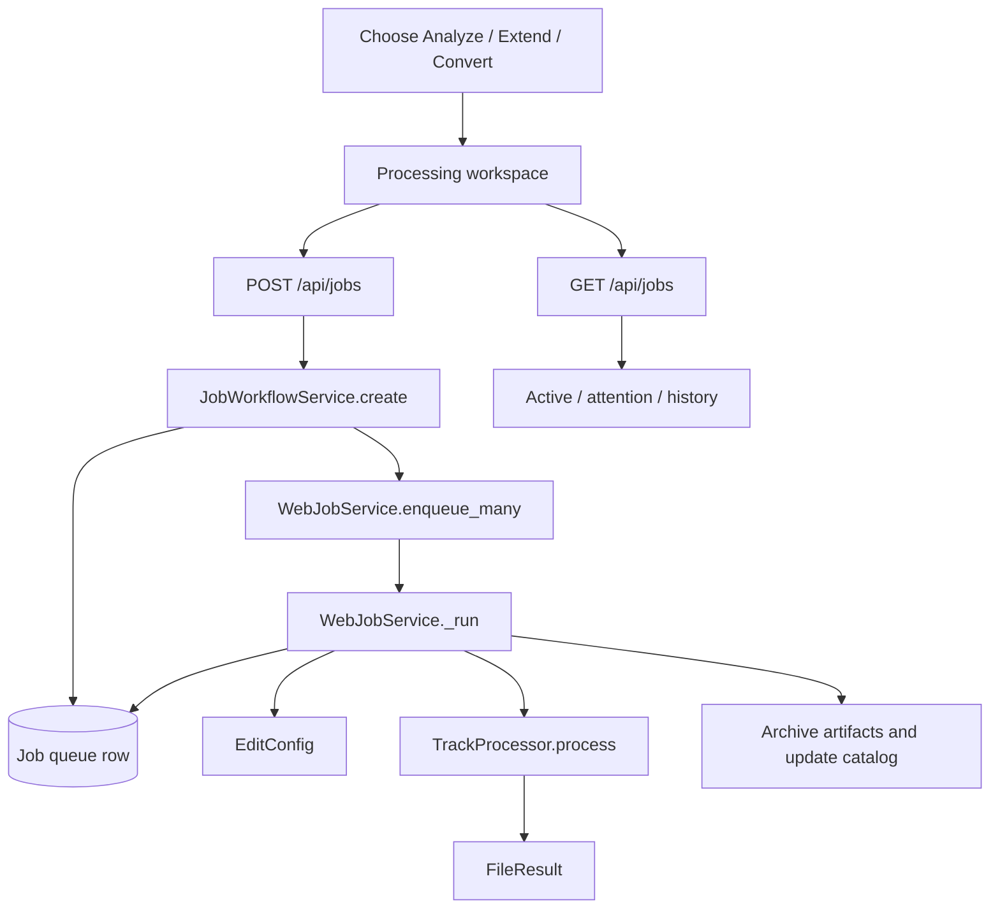
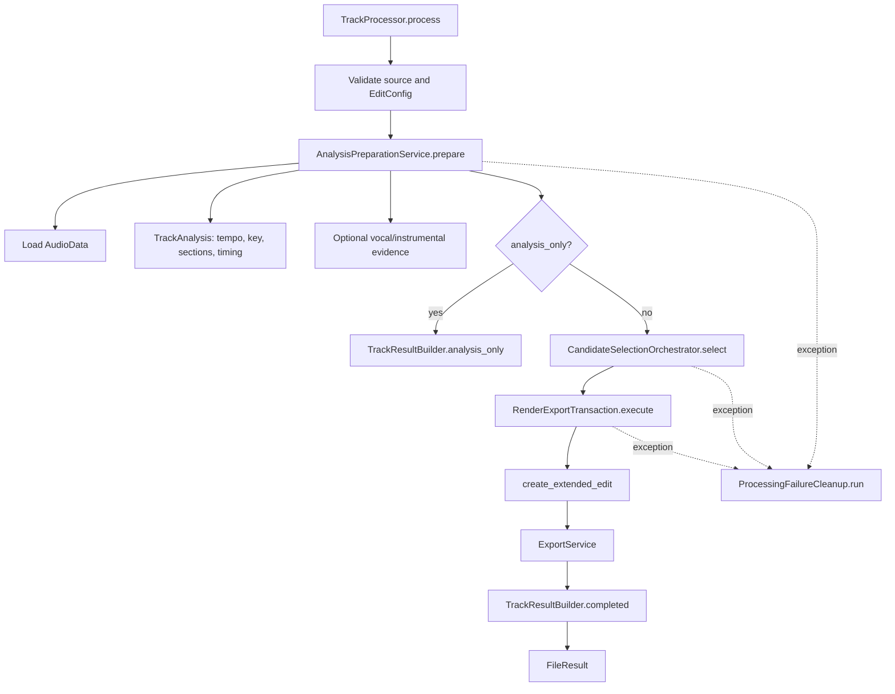

# Track processing flow

Track processing covers the Process page, CLI batch mode, analysis-only jobs,
extended-edit creation, candidate review, artifacts, and queue lifecycle. The
stable transaction boundary for one source is `TrackProcessor.process()`.

## From browser action to worker

`JobWorkflowService` owns upload validation, job creation, preset/override
resolution, and reprocessing policy. `WebJobService` owns scheduling, allowed
parallelism, pause/resume/cancel, database progress, and post-processing
publication. The router only translates HTTP and expected workflow errors.

## The single-track transaction

The authoritative stage order and progress checkpoints are frozen in
[processing-pipeline-contracts.md](../architecture/processing-pipeline-contracts.md).

## Pipeline owners

| Stage                 | Main function/class                                                     | Owns                                                                         |
| --------------------- | ----------------------------------------------------------------------- | ---------------------------------------------------------------------------- |
| Request and reprocess | `JobWorkflowService.create()`, `.reprocess()`                           | Input files, preset selection, overrides, job rows, queue handoff.           |
| Scheduling            | `WebJobService.enqueue()`, `._run()`                                    | Serial/parallel eligibility, lifecycle, `DatabaseProgress`, archive/publish. |
| Load/cache/analyze    | `AnalysisPreparationService.prepare()`                                  | `AudioData`, analysis cache, stem provider, arrangement evidence.            |
| Musical analysis      | `analysis/section_selector.py`, `key_detection.py`, `style_detector.py` | Tempo/key/beat grid, sections, candidates, energy/style/timing evidence.     |
| Candidate choice      | `CandidateSelectionOrchestrator.select()`                               | Intro/outro ranking, manual choice, validation, fallback reason.             |
| Edit assembly         | `create_extended_edit()`                                                | Repetition, boundary optimization, stem-aware construction, joins.           |
| Render/export         | `RenderExportTransaction.execute()`, `ExportService`                    | Extended/source WAVs, previews, auditions, cues, and artifact paths.         |
| Result construction   | `TrackResultBuilder`                                                    | Immutable, consistent `FileResult`.                                          |
| Failure cleanup       | `ProcessingFailureCleanup.run()`                                        | Exactly-once progress stop; exception is re-raised unchanged.                |

## Important models

| Model                                     | Meaning                                                                                                                               |
| ----------------------------------------- | ------------------------------------------------------------------------------------------------------------------------------------- |
| `EditConfig`                              | Immutable processing configuration: bars, stems, thresholds, cache, previews, custom ranges, insertion, cues, and analysis-only mode. |
| `TrackJob`                                | CLI/batch input contract for one source.                                                                                              |
| `AudioData`                               | Loaded samples, sample rate, and audio duration.                                                                                      |
| `TrackAnalysis`                           | Beat grid, tempo/key confidence, arrangement, style, timing, and candidate evidence.                                                  |
| `SectionCandidate`                        | One possible intro/outro section with musical and safety scores.                                                                      |
| `AnalysisStageResult`                     | Loaded audio, analysis, stem evidence, cache flags, timings.                                                                          |
| `SelectionStageResult`                    | Selected intro/outro plus ranked alternatives and explanations.                                                                       |
| `RenderStageResult` / `ExportStageResult` | Audio render and durable artifact outcomes.                                                                                           |
| `FileResult`                              | Complete result used by the web app, CLI, reports, catalog projection, and exports.                                                   |
| `DatabaseProgress`                        | Adapter that writes stage, percent, logs, and attention state to the job row.                                                         |

## Review and media subflows

The processing page reads job state through `createProcessingWorkspaceController()`
and renders it with `createProcessingWorkspaceView()`. Detailed media is loaded
only when needed.

| User action                | Browser owner                                         | Backend path                                     |
| -------------------------- | ----------------------------------------------------- | ------------------------------------------------ |
| View source/extended audio | `processing-job-detail.js`                            | `GET /api/jobs/{id}/audio/{kind}`                |
| View waveform and cues     | `processing-job-detail.js`, candidate waveform editor | waveform and cue routes in `job_media_routes.py` |
| Score a custom transition  | candidate waveform editor                             | `POST /api/jobs/{id}/transition-score`           |
| Review ranked candidates   | `candidate-review.js`                                 | `GET /api/jobs/{id}/candidates`                  |
| Audition a candidate       | `candidate-review.js`                                 | `GET /api/jobs/{id}/candidate/{position}/{rank}` |
| Reprocess with a choice    | candidate review/editor                               | `POST /api/jobs/{id}/reprocess`                  |
| Save candidate feedback    | candidate review                                      | `POST /api/jobs/{id}/feedback`                   |

## Queue and failure states

- Job rows are durable in SQLite; the active worker/executor is process-local.
- On startup, interrupted jobs are recovered to a non-running state.
- Cancel, pause, resume, reorder, remove, and clear are explicit queue actions.
- A stage failure stops later stages: failed analysis cannot render, and failed
  render cannot claim exported artifacts.
- Manual candidate selection pauses at an attention state and resumes through a
  reprocess request rather than mutating a worker in place.
- Cache hits retain the same result contract while skipping expensive analysis.

## CLI relationship

`audioextender/cli.py` and `BatchRunner` use the same `TrackProcessor` and models.
CLI progress uses `_QueueProgress`; web processing uses `DatabaseProgress`. This
keeps musical behavior shared while presentation and scheduling remain separate.

## Verification

- `tests/unit/processing/test_track_processor_characterization.py`
- `tests/unit/processing/test_track_processing_stages.py`
- `tests/unit/analysis/`
- `tests/unit/library/test_export_service.py`
- `tests/integration/test_behavior_workflows.py`
- `tests/javascript/architecture/frontend_workflow_owners.test.js`
- Process/review scenarios in `tests/browser/workflows.spec.js`
