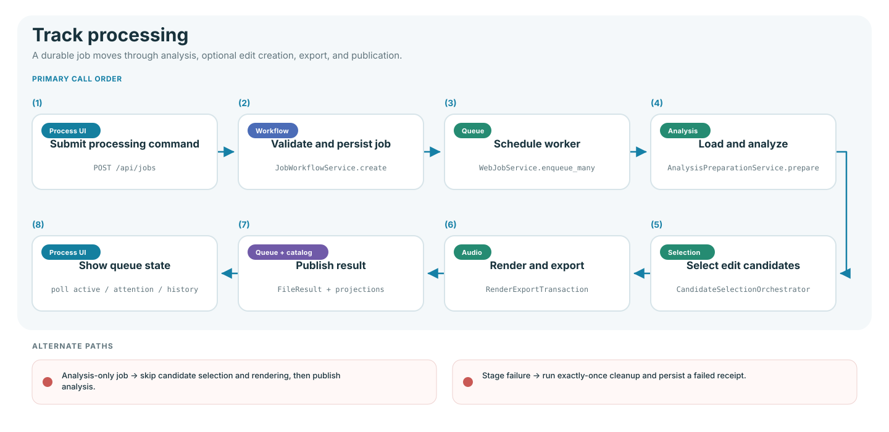

# Track processing flow

The stable transaction boundary for one source is `TrackProcessor.process()`.
The web queue and CLI both use this transaction; only scheduling and progress
presentation differ.

## Stage owners

| Stage            | Owner                            | Output                                  |
| ---------------- | -------------------------------- | --------------------------------------- |
| Request          | `JobWorkflowService`             | Validated durable job row               |
| Scheduling       | `WebJobService`                  | Worker lifecycle and `DatabaseProgress` |
| Preparation      | `AnalysisPreparationService`     | Audio, analysis, stems, cache evidence  |
| Candidate choice | `CandidateSelectionOrchestrator` | Selected and alternate sections         |
| Render/export    | `RenderExportTransaction`        | WAVs, previews, auditions, and cues     |
| Result           | `TrackResultBuilder`             | Immutable `FileResult`                  |
| Failure          | `ProcessingFailureCleanup`       | Exactly-once failed progress state      |

Analysis derives tempo, beat grid, key confidence, arrangement, energy, style,
vocals, and timing evidence. An analysis-only job publishes that evidence without
entering candidate selection or audio rendering.

## Attention and recovery

- Manual candidate selection pauses as an attention state and resumes through a
  reprocess request.
- A failed stage cannot claim later artifacts or completion.
- Cancel, pause, resume, reorder, remove, and clear are explicit queue actions.
- Interrupted jobs are recovered to a non-running state during startup.
- Cache hits keep the same result contract while skipping eligible computation.

The detailed stage and progress contract is frozen in
[processing-pipeline-contracts.md](../architecture/processing-pipeline-contracts.md).

## Verification

`tests/unit/processing/`, `tests/unit/analysis/`,
`tests/integration/test_behavior_workflows.py`, and Process/review scenarios in
`tests/browser/workflows.spec.js`.
